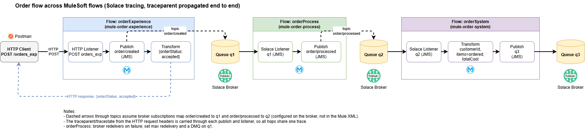
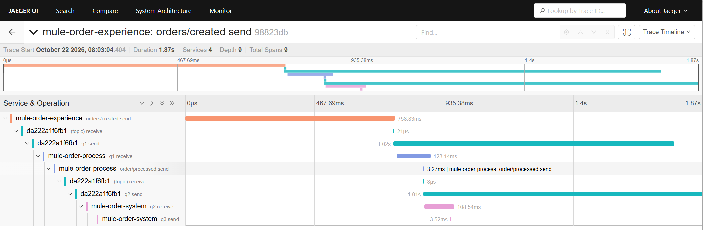

# jms-dt-test

A MuleSoft 4 application that demonstrates distributed tracing across multiple Mule flows using the Solace Tracing connector (i.e. a wrapper for the Mulesoft JMS connector that includes context propagation). A trace started by an HTTP request is carried through each hop (`traceparent` / `tracestate`) via a Solace event broker, so every step shares one end-to-end trace.

## Solace Tracing Connector:

https://github.com/RonInglesby/solace-tracing--connector

## Flow overview



## Flows

### orderExperience (`mule-order-experience`)

| Step | Component | Detail |
|---|---|---|
| 1 | HTTP Listener | `POST /orders_exp` |
| 2 | Logger | Logs the incoming payload |
| 3 | Solace Tracing Publish | Publishes to topic `order/created`. Continues the caller's trace if a `traceparent` header was sent, otherwise starts a new trace. Result stored in `vars.outTrace` so the payload is untouched |
| 4 | Logger | `PRODUCER out` with the trace info |
| 5 | Transform Message | Returns `{ "orderStatus": "accepted" }` to the caller |

### orderProcess (`mule-order-process`)

| Step | Component | Detail |
|---|---|---|
| 1 | Solace Tracing Listener | Consumes from queue `q1` (span `q1 receive`) |
| 2 | Logger | `PROCESS in` with trace context source and `traceparent` |
| 3 | Solace Tracing Publish | Publishes to topic `order/processed`, passing on `traceparent` / `tracestate` |
| 4 | Logger | `PROCESS out` with the trace info |

The listener acknowledges the message when the flow succeeds and asks the broker to redeliver when it fails. Configure a max redelivery count and a dead message queue (DMQ) on `q1` on the broker.

### orderSystem (`mule-order-system`)

| Step | Component | Detail |
|---|---|---|
| 1 | Solace Tracing Listener | Consumes from queue `q2` (span `q2 receive`) |
| 2 | Logger | `SYSTEM in` with trace context source and `traceparent` |
| 3 | Transform Message | Builds the result: `customerId`, each order item set to status `ordered`, and `totalCost` (sum of item prices) |
| 4 | Solace Tracing Publish | Publishes to queue `q3` (destination type `QUEUE`), passing on trace context |
| 5 | Logger | `SYSTEM out` with the trace info |

## Broker configuration

The Mule flows publish to topics (`order/created`, `order/processed`) and consume from queues (`q1`, `q2`). The broker must therefore have:

- Queue `q1` subscribed to topic `order/created`
- Queue `q2` subscribed to topic `order/processed`
- Queue `q3` to receive the final result
- Max redelivery and a DMQ on `q1` (recommended)

These subscriptions are broker-side settings and are not defined in the Mule XML.

## Example request

```bash
curl -X POST http://localhost:<port>/orders_exp \
  -H "Content-Type: application/json" \
  -H "traceparent: 00-<trace-id>-<span-id>-01" \
  -d '{
        "customerId": "C1001",
        "orderItems": [
          { "id": "A1", "price": "10.50" },
          { "id": "B2", "price": "4.25" }
        ]
      }'
```

Response:

```json
{ "orderStatus": "accepted" }
```

The final message on `q3` looks like:

```json
{
  "customerId": "C1001",
  "orderItems": [
    { "id": "A1", "status": "ordered" },
    { "id": "B2", "status": "ordered" }
  ],
  "totalCost": 14.75
}
```

The `traceparent` header is optional. If omitted, `orderExperience` starts a new trace.

## Postman Example request 

POST http://localhost:8081/orders_exp

```json
{ 
    "customerId": "{{$guid}}",
    "customerFirstName": "{{$randomFirstName}}",
    "customerSurname": "{{$randomLastName}}",
    "orderItems": [
        {
            "id" : "{{$randomInt}}",
            "quantity" : {{$randomInt}},
            "price" : {{$randomInt}}.00
        },
        {
            "id" : "{{$randomInt}}",
            "quantity" : {{$randomInt}},
            "price" : {{$randomInt}}.00
        }
    ]
}
```

## Project details

| Item | Value |
|---|---|
| Project name | jms-dt-test |
| Maven artifact | `com.mycompany:jms-dt-bhp3:1.0.0-SNAPSHOT` |
| Packaging | `mule-application` |
| Mule runtime | 4.12.4 |
| Mule Maven plugin | 4.10.1 |

### Connectors

| Connector | Version |
|---|---|
| HTTP (`mule-http-connector`) | 1.12.1 |
| Sockets (`mule-sockets-connector`) | 1.2.10 |
| Solace Tracing (`solace-tracing-connector`) | 2.0.0 |
| JMS (`mule-jms-connector`) | 2.0.0 |

### Source files

- `orderExperience.xml`
- `orderProcess.xml`
- `orderSystem.xml`
- `pom.xml`

## Build and run

```bash
mvn clean package
```

Deploy the resulting `mule-application` JAR to a Mule 4.12.4 runtime (or run from Anypoint Studio), with the `Solace_Tracing_Config` and `HTTP_Listener_config_exp_api` global configs pointing at your broker and HTTP port.

## Observing the trace

Each flow logs the trace context on entry and exit (`PRODUCER out`, `PROCESS in/out`, `SYSTEM in/out`). The `traceparent` trace ID should be identical across all of these log lines, and in your tracing backend all spans should appear under one trace: `orders/created send` → `q1 receive` → `order/processed send` → `q2 receive` → `q3 send`.

## Jaeger 

