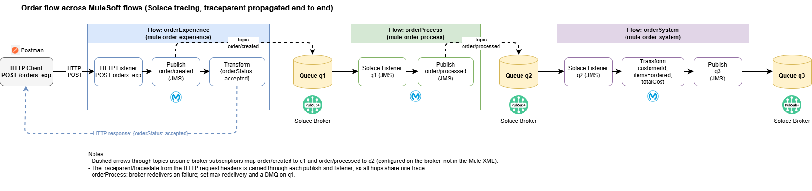
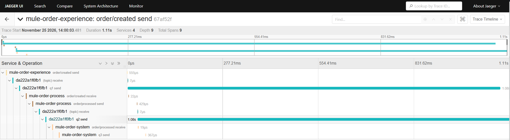

# jms-dt-test

A MuleSoft 4 application that demonstrates distributed tracing across multiple Mule flows using the MuleSoft JMS connector built with Solace tracing (`mule-jms-dt-connector`): the standard `jms:` components, with OpenTelemetry spans and Solace-native context propagation added to the Generic Connection. A trace started by an HTTP request is carried through each hop (`traceparent` / `tracestate`) via a Solace event broker, so every step shares one end-to-end trace.

## JMS connector with Solace tracing

Built from the MuleSoft JMS connector source on the `solace-tracing` branch (see `SOLACE-TRACING.md` in that repository). Install it locally with `mvn clean install -DskipTests -Dmdep.skip=true` using JDK 11.

## Flow overview



## Flows

### orderExperience (`mule-order-experience`)

| Step | Component | Detail |
|---|---|---|
| 1 | HTTP Listener | `POST /orders_exp` |
| 2 | Logger | Logs the incoming payload |
| 3 | JMS Publish | Publishes to topic `order/created` (span `order/created send`). Passes the caller's `traceparent` header as a message property if one was sent, otherwise starts a new trace |
| 4 | Logger | `PRODUCER out` |
| 5 | Transform Message | Returns `{ "orderStatus": "accepted" }` to the caller |

### orderProcess (`mule-order-process`)

| Step | Component | Detail |
|---|---|---|
| 1 | JMS Listener | Consumes from queue `q1` (span `q1 receive`, parented on the broker's span) |
| 2 | Logger | `PROCESS in` with trace context source and `traceparent` |
| 3 | JMS Publish | Publishes to topic `order/processed`, with `attributes.traceparent` as the `traceparent` property |
| 4 | Logger | `PROCESS out` |

The listener uses AUTO ack: the message is acknowledged when the flow succeeds and redelivered when it fails (`maxRedelivery="10"` on the config). Also configure a max redelivery count and a dead message queue (DMQ) on `q1` on the broker.

### orderSystem (`mule-order-system`)

| Step | Component | Detail |
|---|---|---|
| 1 | JMS Listener | Consumes from queue `q2` (span `q2 receive`) |
| 2 | Logger | `SYSTEM in` with trace context source and `traceparent` |
| 3 | Transform Message | Builds the result: `customerId`, each order item set to status `ordered`, and `totalCost` (sum of item prices) |
| 4 | JMS Publish | Publishes to queue `q3` (destination type `QUEUE`), with `attributes.traceparent` as the `traceparent` property |
| 5 | Logger | `SYSTEM out` |

## Broker configuration

The Mule flows publish to topics (`order/created`, `order/processed`) and consume from queues (`q1`, `q2`). The broker must therefore have:

- Queue `q1` subscribed to topic `order/created`
- Queue `q2` subscribed to topic `order/processed`
- Queue `q3` to receive the final result
- Max redelivery and a DMQ on `q1` (recommended)

These subscriptions are broker-side settings and are not defined in the Mule XML.

## Example request

```bash
curl -X POST http://localhost:<port>/orders_exp \
  -H "Content-Type: application/json" \
  -H "traceparent: 00-<trace-id>-<span-id>-01" \
  -d '{
        "customerId": "C1001",
        "orderItems": [
          { "id": "A1", "price": "10.50" },
          { "id": "B2", "price": "4.25" }
        ]
      }'
```

Response:

```json
{ "orderStatus": "accepted" }
```

The final message on `q3` looks like:

```json
{
  "customerId": "C1001",
  "orderItems": [
    { "id": "A1", "status": "ordered" },
    { "id": "B2", "status": "ordered" }
  ],
  "totalCost": 14.75
}
```

The `traceparent` header is optional. If omitted, `orderExperience` starts a new trace.

## Postman Example request 

POST http://localhost:8081/orders_exp

```json
{ 
    "customerId": "{{$guid}}",
    "customerFirstName": "{{$randomFirstName}}",
    "customerSurname": "{{$randomLastName}}",
    "orderItems": [
        {
            "id" : "{{$randomInt}}",
            "quantity" : {{$randomInt}},
            "price" : {{$randomInt}}.00
        },
        {
            "id" : "{{$randomInt}}",
            "quantity" : {{$randomInt}},
            "price" : {{$randomInt}}.00
        }
    ]
}
```

## Project details

| Item | Value |
|---|---|
| Project name | jms-dt-test |
| Maven artifact | `com.mycompany:jms-dt-bhp3:1.0.0-SNAPSHOT` |
| Packaging | `mule-application` |
| Mule runtime | 4.12.4 |
| Mule Maven plugin | 4.10.1 |

### Connectors

| Connector | Version |
|---|---|
| HTTP (`mule-http-connector`) | 1.12.1 |
| Sockets (`mule-sockets-connector`) | 1.2.10 |
| JMS with Solace tracing (`mule-jms-dt-connector`) | 1.11.0-SOLACE-TRACING-1 (local build) |
| Solace JMS API (`sol-jms`, shared library) | 10.17.0 |

### Source files

- `orderExperience.xml`
- `orderProcess.xml`
- `orderSystem.xml`
- `pom.xml`

## Build and run

```bash
mvn clean package
```

Deploy the resulting `mule-application` JAR to a Mule 4.12.4 runtime (or run from Anypoint Studio), with `config.properties` pointing at your broker (JNDI connection factory `solace.jndi.connectionFactory`), your OpenTelemetry Collector (`otel.endpoint`) and the HTTP port. Each flow has its own JMS config (`SOLACE_JMS_EXP`, `SOLACE_JMS_PROCESS`, `SOLACE_JMS_SYSTEM`) so each appears as its own service in Jaeger. `global.xml` also declares the Bitronix transaction manager (`<bti:transaction-manager/>`). The JMS connector build needs it on Mule 4.12 to start; the flows don't use XA.

## Observing the trace

At startup each JMS config logs `JMS tracing enabled: service.name=... Solace-native context available`. The `PROCESS in` and `SYSTEM in` lines log the trace context source (it should be `solace`) and the receive span's `traceparent`; the trace ID should be the same in both. In your tracing backend all spans appear under one trace: `order/created send` → broker spans → `q1 receive` → `order/processed send` → broker spans → `q2 receive` → `q3 send`.

## Jaeger 

mule-... are the mule flows

da222a1f6fb1 is my Solace broker running locally in docker

